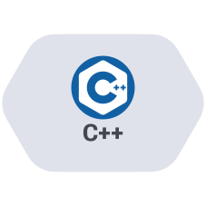
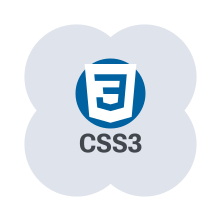
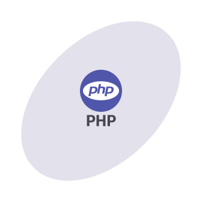
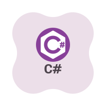
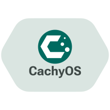
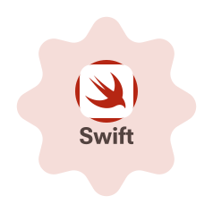

  
💚 **Sponsors**

---

## Hey! I'm XDan :)

I'm the lead developer of [RE//BREAK](https://xdan.cc/rebreak), and a Computer Science, Physics, and Music Production A Level student who mostly writes code for myself, college projects, or to make useful stuff for other people! :D

#### 💻 What I work with

<!-- Android and cross-platform -->

  
  

<!-- Native and game development -->

  
  

<!-- Web development -->

  
  
  
  
  
  

<!-- C# and .NET -->

  
  

<!-- Systems and scripting -->

  
  
  
  

---

#### 🖥️ specs

| Part | 🖥️ **PC** | 💻 **Laptop** | 🍎 **MacBook** |
|------|-----------|---------------|----------------|
| 💼 Model | Custom Build | HP Victus 15 | MacBook Pro 2019
| 🖧 Motherboard | ASUS ROG STRIX B550-F GAMING WI-FI |  |  |
| 🖥️ CPU | AMD Ryzen 5 5600X | Intel Core i5-12450H | Intel Core i9 |
| ❄️ CPU Cooler | Corsair H150X RGB Elite |  |  |
| 📦 RAM | 16GB DDR4 | 16GB DDR4 | 16GB DDR4 |
| 🎮 GPU | XFX AMD Radeon RX 5700 XT 8GB THICC III Ultra | NVIDIA RTX 3050 4GB | AMD Radeon 5500M |
| 🖴 Case | Corsair 4000X RGB |  |  |
| 🐧 OS | CachyOS/Windows 11 | CachyOS/Windows 11 | MacOS 26 Tahoe |
| 🪟 WM/DE | Hyprland | KDE Plasma |  |

---

📫 **find me online:**  
  

  
  
  

---

🫶 **Followers**

<!--
**XDanfr/XDanfr** is a ✨ _special_ ✨ repository because its `README.md` (this file) appears on your GitHub profile.

Here are some ideas to get you started:

- 🔭 I’m currently working on ...
- 🌱 I’m currently learning ...
- 👯 I’m looking to collaborate on ...
- 🤔 I’m looking for help with ...
- 💬 Ask me about ...
- 📫 How to reach me: ...
- 😄 Pronouns: ...
- ⚡ Fun fact: ...
-->
